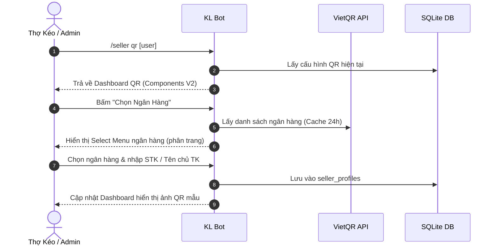
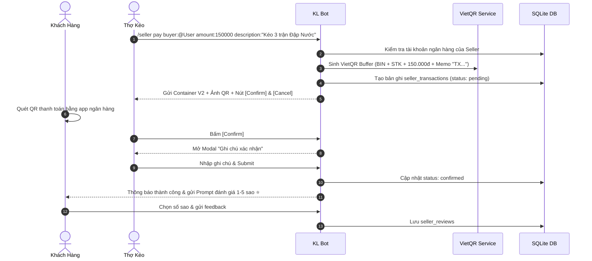

# Thiết Kế Tính Năng: Quản Lý Thợ Kéo (Seller) & Thanh Toán VietQR Tự Động

Tài liệu này mô tả kiến trúc, quy trình nghiệp vụ và kế hoạch triển khai tính năng **Quản lý Thợ Kéo (Seller Management) & Thanh toán VietQR** tích hợp trực tiếp vào **`bot_klb`**.

---

## 1. Mục Tiêu (Goals)

1. **Chuẩn hóa quy trình giao dịch dịch vụ kéo game**: Giúp các "thợ kéo" (sellers) và người thuê kéo (buyers) trong server tạo, kiểm tra và xác nhận thanh toán minh bạch, an toàn.
2. **VietQR Động 100% tự động**: Tự động sinh mã VietQR chuẩn NAPAS 24/7 chứa chính xác số tiền, mã giao dịch (`TX...`) và thông tin ngân hàng của thợ kéo. Khách hàng quét mã là thanh toán ngay, không cần nhập tay số tiền hay nội dung.
3. **Giao diện Discord Components V2**: Áp dụng chuẩn Components V2 đồng bộ của bot (Container, Separator, TextDisplay, Action Buttons, Modals) thay cho Embeds truyền thống.
4. **Cơ sở dữ liệu hiệu năng cao**: Lưu trữ hồ sơ thợ kéo, ngân hàng và lịch sử giao dịch vào **SQLite** (và MongoDB nếu bật), thay thế phụ thuộc Google Sheets cũ để đạt độ trễ 0ms và bảo đảm toàn vẹn dữ liệu (ACID).
5. **Hệ thống Feedback & Đánh giá**: Tự động mở form đánh giá 1-5 sao ⭐ khi giao dịch hoàn tất, xây dựng uy tín cho từng thợ kéo trong server.

---

## 2. Cấu Trúc Lệnh (Slash Command Structure)

Root command: **`/seller`** (hoặc bí danh phù hợp với cộng đồng)

| Subcommand | Mục đích | Phân quyền |
| :--- | :--- | :--- |
| `/seller pay <buyer> <amount> <description> [seller]` | Tạo đơn kéo & hiển thị mã VietQR động | Thợ Kéo hoặc Bot Admin / Moderator |
| `/seller qr [user]` | Dashboard cấu hình tài khoản ngân hàng VietQR cho thợ kéo | Cá nhân thợ kéo hoặc Admin |
| `/seller history [user] [status]` | Xem lịch sử giao dịch của thợ kéo hoặc khách hàng | Thợ Kéo / Admin |
| `/seller top` | Bảng xếp hạng thợ kéo uy tín & doanh thu cao trong server | Mọi thành viên (Public) |
| `/seller config setrole <role>` | Cấu hình role định danh "Thợ Kéo" của server | Bot Admin / Guild Owner |

---

## 3. Kiến Trúc Kỹ Thuật (Vertical Slice Architecture)

Toàn bộ nghiệp vụ được cô lập trong slice **`src/features/seller/`**:

```text
src/features/seller/
├── index.ts                     # Barrel exports
├── types/
│   └── seller.types.ts          # Interfaces, Enums, DTOs
├── services/
│   ├── vietqr.service.ts        # Gọi VietQR API v2, cache ngân hàng, tạo QR buffer
│   └── seller-db.service.ts     # Truy vấn SQLite (thợ kéo, giao dịch, đánh giá)
├── handlers/
│   ├── seller-qr.handler.ts     # Xử lý modal/select chọn ngân hàng & số tài khoản
│   ├── seller-pay.handler.ts    # Xử lý tạo đơn, nút Confirm / Cancel & Modal lý do
│   └── seller-feedback.handler.ts # Xử lý đánh giá sao & lưu feedback
├── ui/
│   ├── seller-qr.container.ts   # UI Components V2 cho QR Dashboard
│   └── seller-pay.container.ts  # UI Components V2 cho Phiếu thanh toán & Trạng thái
└── seller.command.ts            # Slash command builder & routing dispatch
```

---

## 4. Thiết Kế Cơ Sở Dữ Liệu (SQLite Database Schema)

### 4.1. Bảng `seller_profiles` (Thông tin ngân hàng của Thợ Kéo)
* `user_id` (TEXT PRIMARY KEY): Discord User ID của thợ kéo.
* `guild_id` (TEXT): Máy chủ đăng ký.
* `bank_code` (TEXT): Mã BIN ngân hàng VietQR (vd: `970422` - MBBank, `970436` - Vietcombank).
* `bank_name` (TEXT): Tên rút gọn của ngân hàng.
* `account_number` (TEXT): Số tài khoản ngân hàng.
* `account_name` (TEXT): Tên chủ tài khoản (in hoa không dấu).
* `is_active` (INTEGER DEFAULT 1): Trạng thái hoạt động.
* `created_at` (INTEGER): Timestamp tạo.
* `updated_at` (INTEGER): Timestamp cập nhật.

### 4.2. Bảng `seller_transactions` (Lịch sử giao dịch kéo)
* `tx_id` (TEXT PRIMARY KEY): Mã đơn (vd: `TXA1B2C3D4`).
* `guild_id` (TEXT): ID máy chủ thực hiện giao dịch.
* `channel_id` (TEXT): Kênh chat / Ticket tạo giao dịch.
* `message_id` (TEXT): ID tin nhắn chứa bảng QR.
* `buyer_id` (TEXT): Discord ID khách hàng.
* `seller_id` (TEXT): Discord ID thợ kéo.
* `amount` (INTEGER): Số tiền giao dịch (VNĐ).
* `description` (TEXT): Mô tả dịch vụ kéo.
* `status` (TEXT): `pending` | `confirmed` | `cancelled`.
* `note` (TEXT): Ghi chú xác nhận hoặc lý do hủy.
* `processed_by` (TEXT): ID người bấm xác nhận / hủy.
* `created_at` (INTEGER): Thời gian tạo đơn.
* `processed_at` (INTEGER): Thời gian xác nhận / hủy.

### 4.3. Bảng `seller_reviews` (Đánh giá thợ kéo)
* `id` (INTEGER PRIMARY KEY AUTOINCREMENT).
* `tx_id` (TEXT UNIQUE): Khóa ngoại liên kết đơn giao dịch.
* `seller_id` (TEXT): Thợ kéo được đánh giá.
* `buyer_id` (TEXT): Khách hàng đánh giá.
* `rating` (INTEGER): Số sao từ 1 đến 5.
* `comment` (TEXT): Lời nhận xét chi tiết.
* `created_at` (INTEGER): Thời gian gửi đánh giá.

---

## 5. Luồng Nghiệp Vụ Chính (Core User Flows)

### 🔄 Luồng 1: Thiết Lập QR Ngân Hàng (`/seller qr`)


### 💳 Luồng 2: Tạo Đơn & Thanh Toán (`/seller pay`)


---

## 6. Kế Hoạch Triển Khai Từng Bước (Milestones)

- [x] **Bước 1 (Branching & Space)**: Tạo nhánh `feat/seller-payment`, lập tài liệu kỹ thuật, chuẩn bị cấu trúc thư mục `src/features/seller/`.
- [x] **Bước 2 (Database Layer)**: Tạo `src/database/seller.db.ts` với đầy đủ DDL, migrations, query methods.
- [x] **Bước 3 (VietQR Engine)**: Tích hợp `vietqr.service.ts` gọi API VietQR sinh ảnh QR động dạng Buffer, không phụ thuộc canvas nặng nề.
- [x] **Bước 4 (Command & Handlers)**: Xây dựng `/seller qr` và `/seller pay` với Discord Components V2.
- [x] **Bước 5 (Action Router & Interactivity)**: Xử lý nút bấm Confirm/Cancel, select menu ngân hàng, và modal feedback.
- [x] **Bước 6 (RBAC & Permissions)**: Đăng ký policy cho `/seller` vào `permissions.ts`.
- [x] **Bước 7 (Testing & QA)**: Viết unit tests cho database, service và command handler. Chạy `npm run check` và `npm test` đạt 100%.

