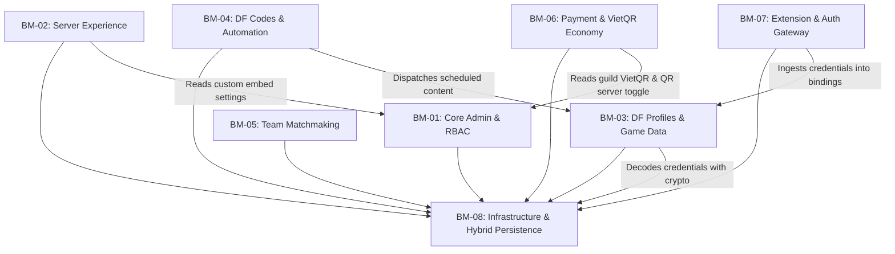

# BUSINESS MODULE DEPENDENCY MAP

**Project:** `bot-klb` (Bot Delta)  
**Version:** 1.6.12  
**Audit Baseline Commit:** `9b51bca`

---

## 1. Inter-Module Dependency Graph

---

## 2. Shared Resources & Data Coupling

### 2.1 Shared Databases & Tables

- `guild_settings` (SQLite) / `guild_settings` (MongoDB):
  - **Writer:** BM-01 (`/config` commands, RBAC, VietQR settings).
  - **Readers:** BM-02 (Welcome/Booster/Container configs), BM-06 (`/pay`, `/donate` QR toggle), BM-04 (AutoPost channel targets).
  - **Concurrency Risk:** Low. SQLite handles synchronous file transactions; MongoDB updates are isolated by `guild_id`.

- `df_account_bindings` & `df_tokens`:
  - **Writer:** BM-07 (`handleClaim` via HTTP claim endpoint) and BM-03 (`/df unlink`).
  - **Readers:** BM-03 (`/df stats`, `/df match`, `/df history`), BM-04 (`/df code`).
  - **Coupling Assessment:** Clean boundary via `resolveUserDfToken` in `df-token.utils.ts`.

### 2.2 Shared In-Memory Stores

- `TTLStore` (`src/utils/ttl-store.ts`):
  - Used by BM-05 (`teamFindSession`), BM-06 (`payCreateCooldown`), BM-08 (`interactionRouter` webhook debounce).
  - Thread-safe in single Node.js event-loop process.

---

## 3. Failure Propagation Paths

| Failure Scenario                                | Originating Module | Propagates To                   | Impact & Blast Radius                                                                                               | Mitigation in Place                                                       |
| ----------------------------------------------- | ------------------ | ------------------------------- | ------------------------------------------------------------------------------------------------------------------- | ------------------------------------------------------------------------- |
| **MongoDB Outage**                              | Cloud MongoDB      | BM-01, BM-03, BM-04             | Low — System seamlessly falls back to local SQLite tables without interrupting bot service.                         | Verified fallback logic in `bootstrap.ts` and `mongo.client.ts`.          |
| **Garena HQ Scraper Outage / Cloudflare Block** | BM-04              | BM-04 (`/df code`, `/df daily`) | Isolated — Scraper error does not crash bot; notifies configured admin channel; falls back to static default codes. | `deltaforce.scraper.ts` with exponential retry + in-flight deduplication. |
| **PayOS API Outage**                            | BM-06              | BM-06 (`/donate`)               | Isolated — Returns user-friendly error container; `/pay create` (P2P VietQR) remains operational.                   | Separated PayOS gateway from P2P VietQR engine.                           |
| **Discord Rate Limit (429)**                    | Discord API        | All Modules                     | Broad — Deferred interactions prevent 3-second timeout, but heavy message bursts could stall gateway event loop.    | Early deferReply pattern implemented across all heavy slash commands.     |
