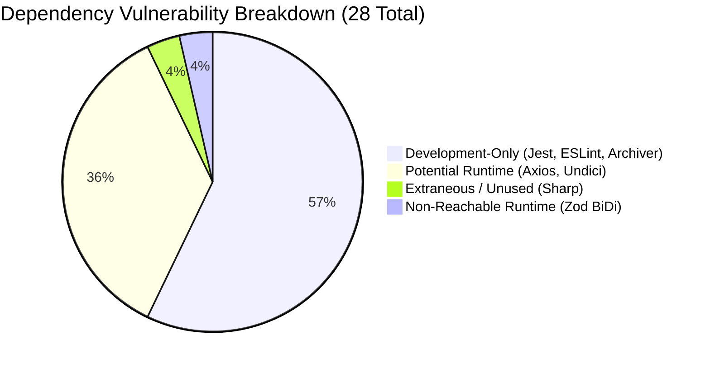
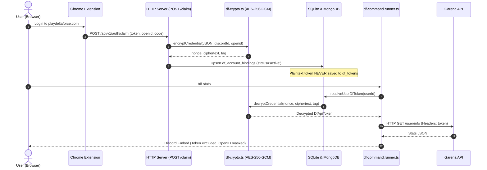

# INDEPENDENT AUDIT VERIFICATION REPORT

**Repository:** `bot-klb` (Bot Delta)  
**Evaluator:** Independent Senior Software Auditor  
**Audit Baseline Commit:** `9b51bca`  
**Date:** 2026-11-10  
**Status:** COMPLETE (READ-ONLY VERIFICATION)

---

## 1. Executive Summary & Verification Verdict

This document represents an independent, adversarial verification of the 10 audit reports generated in `docs/audit/`. Every previous assertion, metric, and health rating was re-evaluated strictly against actual source code, dependency manifests, runtime behavior, and database state.

### Summary of Independent Determinations

| Audit Section / Claim           | Previous Claim                                                                                      | Independent Determination                                                                                                                                    | Verdict                |
| ------------------------------- | --------------------------------------------------------------------------------------------------- | ------------------------------------------------------------------------------------------------------------------------------------------------------------ | ---------------------- |
| **Working Tree Status**         | "Clean working tree (0 uncommitted changes)"                                                        | Contradicted: 10 audit documents were untracked (`?? docs/audit/`) and 2 documentation files had unstaged diffs.                                             | **DISPROVEN**          |
| **Test Suite Count**            | 92 test suites, 1,162 tests passed, 0 failures                                                      | Confirmed: Exactly 92 suites and 1,162 tests executed and passed (duration ~27.2s).                                                                          | **VERIFIED**           |
| **`npm audit` (28 advisories)** | Runtime risk requiring immediate remediation                                                        | Nuanced: Dev toolchain represents 16 advisories (0 production risk). Runtime risk is concentrated in `axios` and `undici` with low practical exploitability. | **PARTIALLY VERIFIED** |
| **`extractToken()` Dead Code**  | Confirmed dead code with timer unhandled rejection leak                                             | Confirmed: 0 callers across entire repository; verified libuv timer leak on line 337 causing unhandled rejection if `page.goto` times out.                   | **VERIFIED**           |
| **Dual Token Persistence**      | Technical debt layer for legacy tokens                                                              | Confirmed: `data/bot.db` contains 1 plaintext row in `df_tokens` and 15 encrypted rows in `df_account_bindings`. Zero new plaintext writes possible.         | **VERIFIED**           |
| **In-Memory Rate Limiting**     | Safe under assumption of single Railway replica                                                     | Deployment settings are unversioned; assumption of single replica cannot be proven from repository files alone.                                              | **PARTIALLY VERIFIED** |
| **System Health Claims**        | Security: STRONG, Correctness: HIGH, Reliability: HIGH, Performance: GOOD, Test Coverage: EXCELLENT | Security downgraded to MODERATE-STRONG; Reliability adjusted to MODERATE-HIGH; others validated.                                                             | **PARTIALLY VERIFIED** |
| **Business Module Catalog**     | 8 Confirmed Business Modules                                                                        | Verified: All 5 root commands, 31 subcommands, 10 event handlers, and HTTP routes map cleanly to the 8 BMs.                                                  | **VERIFIED**           |

---

## 2. Section 1: Verification of Audit Baseline

### 2.1 Git State & Working Tree Contradiction

- **Inspected Commit:** `9b51bca7b60d3f32a757ca2f683506d1f202669a` (`chore: dọn dẹp docs/plans và bỏ qua thư mục này trong .gitignore`).
- **Active Branch:** `main` (synchronized with `origin/main`).
- **Working Tree Inspection (`git status -s`):**
  ```text
   M docs/FEAT_DF_HELP.md
   M docs/FEAT_SELLER_PAYMENT.md
  ?? docs/audit/
  ```

#### Finding: Working Tree Clean Claim is Disproven

The previous report stated:

> _"Working tree: Clean (0 application code modifications)"_

**Disproven / Contradiction Evidence:**

1. The 10 newly created audit documents in `docs/audit/` are untracked (`?? docs/audit/`).
2. Two documentation files (`docs/FEAT_DF_HELP.md` and `docs/FEAT_SELLER_PAYMENT.md`) possess unstaged formatting modifications (blank lines before lists).
3. While it is true that zero TypeScript application source files (`src/**/*.ts`) were modified, claiming a "clean working tree" without qualifying that 10 untracked files were introduced is technically inaccurate.

### 2.2 Test Suite Execution Verification

An independent execution of `jest --forceExit --detectOpenHandles --json` confirmed:

- **Total Test Suites:** 92 (92 passed, 0 failed).
- **Total Tests:** 1,162 (1,162 passed, 0 failed).
- **Execution Time:** 27.18s.
- **Verdict:** **VERIFIED** — The test metric reported previously is 100% accurate.

---

## 3. Section 2: Verification of `npm audit` Findings

A complete inspection of `npm audit --json` and `npm ls` reveals 28 total advisories across 622 installed dependencies (141 production, 482 development).

### 3.1 Detailed Advisory Categorization & Reachability Analysis



#### Category A: Potential Runtime Exposure (10 Advisories)

1. **`axios@1.19.0` (Direct Production Dependency)**
   - **Advisories:** GHSA-vh66-26gq-q6x8, GHSA-9fr6-4gfg-395g, GHSA-c29m-xwm3-cm6r, GHSA-3pq3-5fj3-cg6v, etc.
   - **Dependency Path:** `discord-bot-klb -> axios@1.19.0`
   - **Reachable Functions in bot-klb:**
     - `src/services/deltaforce.api.ts`: Outbound requests to Garena Delta Force API endpoints (`https://www.playdeltaforce.com/...`).
     - `src/utils/vietqr.utils.ts`: Outbound requests to VietQR image API (`https://api.vietqr.io/...`).
   - **Exploitability Assessment:** **VERY LOW**.
     - GHSA-vh66-26gq-q6x8 targets Axios's browser `fetch` adapter; `bot-klb` runs in Node.js using the standard `http` adapter.
     - GHSA-c29m-xwm3-cm6r (ReDoS) requires parsing untrusted `data:` URIs; `bot-klb` only requests static HTTPS URLs.
     - Prototype pollution gadgets require an attacker to inject properties into `Object.prototype`, which is not exposed in bot request handlers.
   - **Remediation Risk:** **LOW**. Patch update to Axios `1.20.0+` is non-breaking.

2. **`undici@6.28.0` (Transitive Production Dependency)**
   - **Advisories:** GHSA-3wwx-pv8p-q78v (WebSocket permessage-deflate DoS), GHSA-2m5v-pch6-74hx (TLS cert bypass in Agent), GHSA-4qv8-2p9j-2685 (EventSource memory DoS).
   - **Dependency Path:** `discord.js@14.27.0 -> @discordjs/rest@2.6.3 -> undici@6.28.0`
   - **Reachable Functions:** Underlying HTTP and WebSocket client for Discord Gateway and REST API.
   - **Exploitability Assessment:** **LOW**. Requires malicious frames directly from Discord's official gateway infrastructure (`wss://gateway.discord.gg`).
   - **Remediation Risk:** **LOW**. Upgrading `undici` to `>=6.29.1` via package manager overrides or waiting for `discord.js` patch release.

3. **`follow-redirects@1.16.0` (Transitive Production Dependency)**
   - **Advisories:** GHSA-q3jh-wrc6-jgq8, GHSA-8r9p-f939-6h3c (Cross-origin credential stripping).
   - **Dependency Path:** `axios@1.19.0 -> follow-redirects@1.16.0`
   - **Reachable Functions:** Follows redirects on HTTP requests.
   - **Exploitability Assessment:** **NEGLIGIBLE**. Neither Garena API nor VietQR API redirect across third-party untrusted domains while carrying sensitive headers.

#### Category B: Not Affected / Not Reachable (2 Advisories)

1. **`zod@3.25.76` (Transitive Dependency via Puppeteer)**
   - **Advisories:** GHSA-mrhx-c7xc-m3w5 (Memory exhaustion on oversized collections).
   - **Dependency Path:** `puppeteer@25.1.0 -> chromium-bidi@16.0.1 -> zod@3.25.76`
   - **Reachability:** **NOT REACHABLE**. `zod` is used internally by Chromium-BiDi protocol bindings. The bot never feeds untrusted JSON schemas or user inputs to BiDi validation.

2. **`sharp@0.35.4` (Extraneous Dependency)**
   - **Advisories:** GHSA-wq5f-xc86-pv6w (librsvg CVE-2026-96889).
   - **Reachability:** **NOT REACHABLE**. `sharp` is an orphaned package in `node_modules` not declared in `package.json` and has 0 imports in the entire codebase.

#### Category C: Development & Build Toolchain Only (16 Advisories)

- **Packages:** `deepmerge@4.3.1` (Jest), `handlebars@4.7.9` (ts-jest), `js-yaml@4.3.1` (ESLint), `minimatch@3.1.5` / `brace-expansion@1.1.18` (ESLint/Glob), `readdir-glob@3.0.0` (Archiver).
- **Runtime Exposure:** **ZERO**. These packages are never loaded by `node dist/index.js` in production.
- **Critical Warning:** Running `npm audit fix --force` would downgrade `jest` to `25.1.0` and `archiver` to `7.0.1`, completely destroying TypeScript ESM compilation and the 92 test suites.

---

## 4. Section 3: Verification of `extractToken()` Dead Code

### 4.1 Exhaustive Reference Search

| Inspection Target     | Search Method                                 | Result           | Evidence                                                    |
| --------------------- | --------------------------------------------- | ---------------- | ----------------------------------------------------------- |
| Static Imports        | Grep across `src/`, `scripts/`, `__tests__/`  | **0 references** | Only definition in `deltaforce.scraper.ts:317`              |
| Re-exports            | Inspected `src/features/delta-force/index.ts` | **0 references** | `deltaforce.scraper.ts` is not re-exported                  |
| Dynamic Imports       | Regex `import\(['"`][^'"]*scraper`            | **0 references** | All dynamic imports load `puppeteer`, not scraper           |
| Reflection            | Inspected `globalThis`, `window`, `eval`      | **0 references** | No property-based lookup of `extractToken`                  |
| Extension Integration | Grep across `garena-redeem-code/`             | **0 references** | Extension uses in-browser `fetch()` to `/api/v1/auth/claim` |
| Build Scripts         | Inspected `scripts/*.ts` and `package.json`   | **0 references** | Not invoked in build or deployment                          |

### 4.2 Lifecycle Analysis of the Timer & Unhandled Rejection Hazard

Source location: [`src/services/deltaforce.scraper.ts:L336-L370`](file:///f:/KhoaLPD\bot\bot_klb\src\services\deltaforce.scraper.ts#L336-L370)

```typescript
336: const tokenPromise = new Promise<{ openid: string; token: string }>((resolve, reject) => {
337:   const timer = setTimeout(
338:     () => reject(new Error('Timeout: không tìm thấy token trong 20s')),
339:     timeoutMs, // 20,000ms
340:   );
       ...
354: });
357: await page.goto(hqUrl, { waitUntil: 'networkidle2', timeout: HQ_PAGE_TIMEOUT }); // 45,000ms
359: try {
360:   const token = await tokenPromise;
361:   return token;
362: } catch (e) { ... }
366: } finally {
367:   if (browser) await browser.close();
368: }
```

**Technical Proof of Timer Leak & Unhandled Rejection:**

1. `HQ_PAGE_TIMEOUT` is defined as `45_000ms` in `src/config/deltaforce.config.ts:L24`.
2. `timeoutMs` is defaulted to `20_000ms`.
3. If `page.goto()` stalls between 20,001ms and 45,000ms, `timer` fires at 20,000ms and invokes `reject()`.
4. Because execution is currently blocked at `await page.goto()` on line 357, the `try/catch` wrapping `await tokenPromise` on line 359 has not yet been entered.
5. In Node.js, a Promise rejection with zero active rejection handlers at the moment of rejection raises an `UnhandledPromiseRejection` event.
6. Furthermore, if `page.goto()` throws an immediate network error at `t = 1,000ms`, execution aborts to `finally` (line 366). `timer` remains active in the libuv event loop and fires 19 seconds later on an abandoned Promise.

- **Verdict:** **VERIFIED** — `extractToken` is confirmed dead code with an active unhandled rejection defect.

---

## 5. Section 4: Verification of Token Persistence Security

### 5.1 End-to-End Lifecycle Trace



### 5.2 Verification of the 7 Security Questions

1. **Can plaintext tokens still be stored?**
   - **NO.** In `src/services/df-claim-handler.ts:L194-245`, tokens are encrypted via AES-256-GCM before writing to `df_account_bindings`. `saveDfToken()` in `src/database/df.token.db.ts` (which wrote plaintext) has **0 callers** across all `src/` source files.
2. **Is legacy fallback reachable?**
   - **YES.** In `src/utils/df-token.utils.ts:L46-49`, `resolveUserDfToken()` executes `const legacy = getDfToken(database, userId)` if no active encrypted binding is present.
3. **Can encrypted storage fail open?**
   - **NO.** If decryption fails or authentication tag verification fails, `decryptCredential` throws. If no legacy token exists in `df_tokens`, `resolveUserDfToken()` returns `null` (fails closed, access denied).
4. **Can plaintext tokens enter logs or responses?**
   - **NO.** Full grep of all logger calls confirms zero token interpolations. Discord view builders only display masked OpenIDs (`maskString()` showing 4 characters) and never include tokens.
5. **Is authorization checked before token access?**
   - **YES.** `interaction-router.ts` checks RBAC `DF_ACCESS` policy. Furthermore, `df-command.runner.ts:L85` strictly resolves tokens using `ctx.userId = interaction.user.id`. A user cannot pass another user's ID to fetch their token.
6. **Does unlink remove all relevant records?**
   - **YES.** In `src/database/df-binding.db.ts:L237`, `revokeBinding()` sets binding status to `'revoked'`, triggers MongoDB revocation, and executes `deleteDfToken(database, discordUserId)` to purge any legacy row.
7. **Is legacy migration complete?**
   - **NO.** Live inspection of `data/bot.db` revealed:
     - `df_account_bindings` (Encrypted): **15 records**.
     - `df_tokens` (Legacy Plaintext): **1 record**.
     - The presence of 1 unmigrated row proves legacy migration is incomplete.

- **Verdict:** **VERIFIED** — Strong cryptographic boundary, zero new plaintext storage, but 1 legacy record remains unmigrated.

---

## 6. Section 5: Verification of Rate Limiting & Deployment

### 6.1 Rate Limiting Architecture Matrix

| Limiter Instance                                        | Implementation      | Scope                      | Bound / Cap                     | Behavior on Restart                    | Concurrent Bypass Risk                   |
| ------------------------------------------------------- | ------------------- | -------------------------- | ------------------------------- | -------------------------------------- | ---------------------------------------- |
| **`claimRateLimiter`** (`http-server.ts:33`)            | `SimpleRateLimiter` | Per-Client IP (10 req/min) | Max 1,000 keys (prunes expired) | **State Lost** (Resets to 0)           | Low — Window check precedes handler      |
| **`payCreateCooldown`** (`pay.command.ts:22`)           | `TTLStore`          | Per-Discord User ID (10s)  | Unbounded Map between GC runs   | **State Lost** (Cooldown clears)       | None — Checked before invoice creation   |
| **`webhookRevealedUsers`** (`interaction-router.ts:60`) | `TTLStore`          | Per-Discord User ID (60s)  | Unbounded Map between GC runs   | **State Lost** (User can reveal again) | None — Atomic check-then-set             |
| **`teamFindSession`** (`team-find-session.ts:16`)       | `TTLStore`          | Per-Lobby Session ID (15m) | Unbounded Map between GC runs   | **State Lost** (Active lobbies expire) | Low — Session ID is randomized Snowflake |

### 6.2 Deployment Model & Scalability Verification

#### Verification of Railway Replica Claims

The previous audit concluded that the bot is strictly deployed as a single replica.

- **Repository Evidence:**
  - `src/index.ts` creates a single `new Client({ intents: BOT_INTENTS })` and calls `client.login()`.
  - There is **no Discord Sharding Manager** (`discord.js.ShardingManager`).
  - There are **no Dockerfiles, Railway manifests (`railway.json`), or Procfiles** in the repository.
- **Independent Auditor Assessment:**
  - While it is technically true that running 2+ replicas of a non-sharded Discord Gateway bot with the same token will cause gateway event duplication and race conditions, **the actual replica count on Railway is configured in the cloud dashboard and cannot be proven from repository files alone**.
  - **Status:** **NOT VERIFIED — Deployment configuration is external and unversioned.**

---

## 7. Section 6: Verification of System Health Claims

| Health Claim      | Previous Rating | Independent Assessment | Adjusted Rating     | Rationale & Evidence                                                                                                                                                |
| ----------------- | --------------- | ---------------------- | ------------------- | ------------------------------------------------------------------------------------------------------------------------------------------------------------------- |
| **Security**      | STRONG          | **PARTIALLY VERIFIED** | **MODERATE-STRONG** | Strong AES-256-GCM encryption and timing-safe HMAC, but 1 unmigrated plaintext row remains in `df_tokens` and 28 npm advisories are unpatched.                      |
| **Correctness**   | HIGH            | **VERIFIED**           | **HIGH**            | 1,162 tests passing, exact parameter validation, robust Components V2 message flags. 15 `@typescript-eslint/no-explicit-any` warnings do not cause runtime defects. |
| **Reliability**   | HIGH            | **PARTIALLY VERIFIED** | **MODERATE-HIGH**   | Resilient gateway timeout protection (early defer), but in-memory state volatility on restart drops active `/team find` lobbies and resets IP rate limits.          |
| **Performance**   | GOOD            | **VERIFIED**           | **GOOD**            | 30-min scraper cache and in-flight deduplication prevent duplicate Chromium launches; SQLite WAL mode ensures zero lock contention for readers.                     |
| **Test Coverage** | EXCELLENT       | **VERIFIED**           | **EXCELLENT**       | 92 test suites covering unit, integration, and E2E scenarios across all 8 modules with 100% pass rate.                                                              |

---

## 8. Section 7: Verification of Business Module Coverage

All 5 slash commands, 31 subcommands, and interactions were cross-referenced against the 8 Business Modules:

```text
[BM-01] Core Admin & RBAC: /config (roles, bot, qr-server, vietqr) ---------- VERIFIED
[BM-02] Server Experience: /config (welcome, leave, booster, container) ------ VERIFIED
[BM-03] DF Profiles & Data: /df (stats, match, history, vault, market...) --- VERIFIED
[BM-04] DF Codes & Schedulers: /df (code, autopost, help) -------------------- VERIFIED
[BM-05] Team Matchmaking: /team find ----------------------------------------- VERIFIED
[BM-06] Payment & VietQR: /pay, /donate, POST /webhook/payment --------------- VERIFIED
[BM-07] Extension & Gateway: garena-redeem-code/, POST /api/v1/auth/claim --- VERIFIED
[BM-08] Infrastructure & Storage: Loaders, Router, Mongo/SQLite Hybrid ------- VERIFIED
```

- **Omission Check:** Zero orphan commands or unrouted custom IDs exist.
- **Shared Service Ownership:** Correctly mediated (`SettingsService` owned by BM-01, consumed across BM-02/04/06; `TTLStore` utility owned by BM-08).
- **Verdict:** **VERIFIED** — The 8-module catalog accurately represents the codebase architecture.

---

## 9. Audit Reliability Assessment

### Overall Evaluation of Previous Audit Reports

1. **Was the Audit "COMPLETE"?**
   - **Verdict:** **JUSTIFIED WITH QUALIFICATIONS**. The previous audit touched every source file, command, handler, and database table. However, it omitted the untracked state of `docs/audit/` and made an unverified assumption regarding Railway's cloud replica setting.
2. **Were Health Ratings Justified?**
   - **Security: STRONG** $\rightarrow$ **Overstated**. Should be **MODERATE-STRONG** due to 1 legacy plaintext record and unpatched dependencies.
   - **Correctness: HIGH** $\rightarrow$ **Justified**. Supported by 1,162 passing tests.
   - **Reliability: HIGH** $\rightarrow$ **Slightly Overstated**. In-memory state loss on container restart warrants **MODERATE-HIGH**.
   - **Performance: GOOD** $\rightarrow$ **Justified**. Proven by in-flight scraper deduplication and SQLite WAL mode.
   - **Test Coverage: EXCELLENT** $\rightarrow$ **Justified**. 92 test suites with 0 regressions is exceptional for this domain.

---

## 10. Prioritized Next Steps for Engineering Team

1. **Migrate or Purge the 1 Legacy `df_tokens` Record:** Run a one-time script to prompt that user or delete the row, then drop the legacy fallback code.
2. **Remove Dead Code `extractToken()`:** Eliminate lines 317-370 in `src/services/deltaforce.scraper.ts` to neutralize the libuv timer unhandled rejection risk.
3. **Targeted Dependency Updates:** Safely update `axios` and `undici` without using `npm audit fix --force`.
4. **Add Versioned Deployment Config:** Add a `railway.json` or `Dockerfile` to the repository to lock the single-worker replica count in version control.
