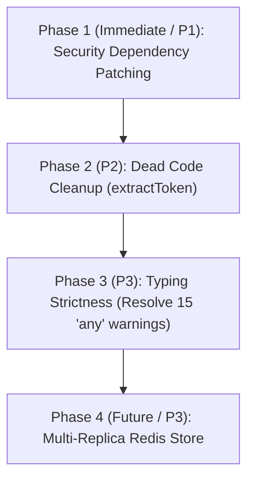

# REFACTOR ROADMAP

**Project:** `bot-klb` (Bot Delta)  
**Version:** 1.6.12  
**Audit Baseline Commit:** `9b51bca`

---

## 1. Prioritized Remediation Roadmap

The following roadmap is ranked strictly by security and reliability impact.

---

## 2. Detailed Task Breakdown

### Phase 1: Security Dependency Patching (P1 — High Priority)

- **Objective:** Eliminate identified high-severity advisories in runtime dependencies (`axios`, `undici`, `puppeteer`).
- **Target Files:** `package.json`, `package-lock.json`
- **Execution Command:** `npm audit fix` (avoiding breaking changes with `--force`).
- **Verification:** Run `npm run check`, `npm test`, and `npm audit`.
- **Expected Benefit:** Neutralizes prototype pollution and ReDoS attack surfaces.
- **Risk:** Low (patch version bump).

### Phase 2: Dead Code Removal (P2 — Medium Priority)

- **Objective:** Delete unused function `extractToken` in `src/services/deltaforce.scraper.ts:L317-370`.
- **Target File:** `src/services/deltaforce.scraper.ts`
- **Verification:** Run `npm run check` and `npm test __tests__/df/deltaforce.scraper.test.ts`.
- **Expected Benefit:** Removes ~55 lines of dead code and eliminates potential timer unhandled rejection.
- **Risk:** Zero (0 callers across the repository).

### Phase 3: Typing Strictness (P3 — Low Priority / Maintenance)

- **Objective:** Replace 15 `@typescript-eslint/no-explicit-any` usages with concrete or generic types (`unknown`, `Record<string, unknown>`).
- **Target Files:**
  - `src/config/permissions.ts`
  - `src/features/delta-force/autopost.handler.ts`
  - `src/features/delta-force/match.handler.ts`
  - `src/features/payment/pay.command.ts`
  - `src/features/payment/payment-flow.ts`
  - `src/infrastructure/discord/event-loader.ts`
  - `src/services/deltaforce.api.ts`
  - `src/services/df-autopost-scheduler.ts`
- **Verification:** `npm run lint` yields 0 warnings.
- **Risk:** Low.

### Phase 4: Horizontal Scaling Preparation (P3 — Future Architecture)

- **Objective:** If the bot expands to multiple concurrent container replicas, introduce a Redis adapter interface for `TTLStore` and `SimpleRateLimiter`.
- **Affected Modules:** BM-05 (`team-find`), BM-06 (`payCreateCooldown`), BM-07 (`claimRateLimiter`).
- **Expected Benefit:** Preserves party lobbies and IP rate-limiting consistency across load-balanced pods.
- **Risk:** Medium (requires infrastructure provision).
