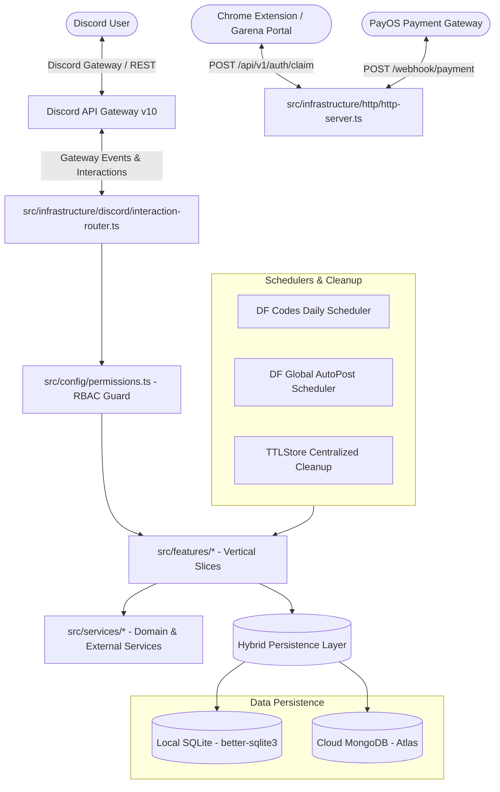

# SYSTEM ARCHITECTURE

**Project:** `bot-klb` (Bot Delta)  
**Version:** 1.6.12  
**Audit Baseline Commit:** `9b51bca`  
**Classification:** Discord Bot & Web Companion Service

---

## 1. High-Level Architecture Overview

`bot-klb` is a hybrid TypeScript application operating simultaneously as a Discord Gateway client, a native HTTP microservice, a scheduled background worker, and a companion Chrome Extension gateway.

---

## 2. Application Lifecycle & Bootstrap Sequence

The application bootstrap sequence is orchestrated deterministically in `src/app/bootstrap.ts`:

1. **Database Schema Initialization**:
   - `welcome.database.ts`: Core SQLite connection with WAL mode enabled.
   - `guild.settings.db.ts`: Guild-level settings and JSON blobs.
   - `payment.db.ts`: `payments`, `payment_feedback`, and `donations` tables.
   - `df.token.db.ts`: Legacy Delta Force token credentials table.
   - `df-claim.db.ts`: Ephemeral claim sessions for account linking.
   - `df-binding.db.ts`: AES-256-GCM encrypted account binding table.
   - `df-telemetry.db.ts`: Capture telemetry events for audit trails.
   - `df-autopost.db.ts`: Scheduled broadcast configurations.
   - `df-loadouts.db.ts`: Weapon build and loadout presets.

2. **Cloud MongoDB Sync (Optional / Resilient)**:
   - If `MONGODB_URI` is present, `connectMongo` initializes collections and compound indexes.
   - Executes unidirectional startup sync (`syncBindingsFromMongoToSqlite`, `syncAutoPostFromMongoToSqlite`) to ensure local SQLite contains full state.

3. **Cryptographic Initialization**:
   - `initCryptoKey('v1')`: Reads `DF_CRED_KEY_V1` (32 bytes Base64) to prime AES-256-GCM cipher registry.

4. **Configuration & RBAC Loading**:
   - Initializes `SettingsService` with local SQLite and preloads MongoDB cache.
   - Reads `permissions.json` (or falls back to `DEFAULT_PERMISSIONS`) into memory.

5. **Dynamic Metadata Preloading**:
   - `refreshDfMetadata()`: Preloads Delta Force operators, seasons, and map names from official CDN.

6. **Discord Client & Interaction Routing**:
   - Spawns `Client` with intents: `Guilds`, `GuildMembers`, `GuildMessages`, `GuildVoiceStates`, `MessageContent`.
   - Auto-discovers and registers commands via `loadCommands()`.
   - Registers Discord event listeners via `loadEvents()`.

7. **In-Memory Store Cleanup Jobs**:
   - Starts periodic GC for `ContainerSession`, `teamFindSession`, `claimSession`, and `TTLStore`.

8. **Deployment & Login**:
   - Deploys REST Application Commands to Discord API.
   - Authenticates gateway with `client.login(botConfig.token)`.

9. **Post-Login Workers & HTTP Server**:
   - Launches `startDfCodesScheduler()` (cron: daily code broadcast).
   - Launches `startDfAutoPostScheduler()` (cron: multi-server content broadcaster).
   - Starts native `http.Server` on port `PORT` (handling `/health`, `/api/v1/auth/claim`, and `/webhook/payment`).

---

## 3. Entry Points & Runtime Boundary

| Entry Point                                  | Protocol   | Port / Transport          | Primary Purpose                                                                     |
| -------------------------------------------- | ---------- | ------------------------- | ----------------------------------------------------------------------------------- |
| `src/index.ts`                               | Process    | Node.js Runtime           | Main process supervisor, signal handling (`SIGTERM`/`SIGINT`), graceful shutdown    |
| `src/infrastructure/discord/event-loader.ts` | WebSocket  | Discord Gateway           | Ingests Discord events (`interactionCreate`, `guildMemberAdd`, etc.)                |
| `src/infrastructure/http/http-server.ts`     | HTTP/1.1   | TCP `PORT` (default 3000) | REST API for Chrome Extension claim token, PayOS webhooks, Railway health checks    |
| `scripts/deploy-commands.ts`                 | CLI / REST | Discord REST API v10      | One-off guild/global command registration script                                    |
| `scripts/package-extension.ts`               | CLI        | Node.js File System       | Generates zipped Chrome Extension bundle in `src/assets/downloads/DF-Extension.zip` |

---

## 4. Architectural Boundaries & Conventions

- **Vertical Slice Architecture**: Code grouped by business capability under `src/features/<feature>/` (`admin`, `booster`, `container`, `delta-force`, `payment`, `welcome`).
- **Module Resolution**: `node16` with mandatory `.js` relative import extensions.
- **Strict Isolation**: Feature slices own their command handlers and view templates; shared cross-cutting concerns reside in `src/services/` and `src/utils/`.
- **Hybrid Storage Model**: SQLite acts as fast local zero-latency query cache; MongoDB acts as persistent cross-container backup on cloud platforms like Railway.
